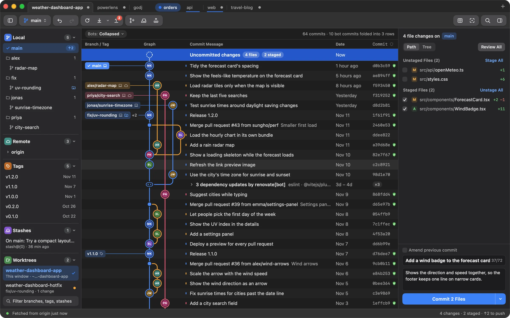
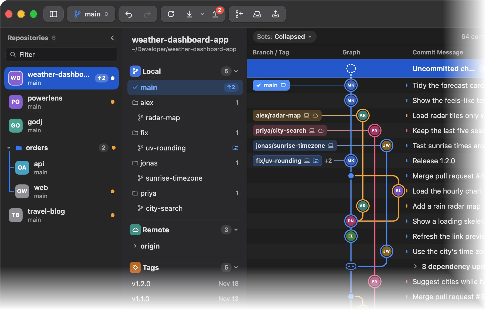
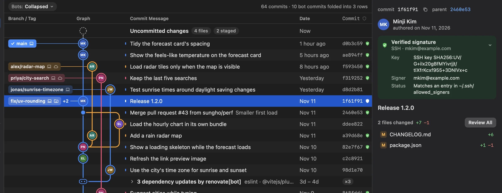
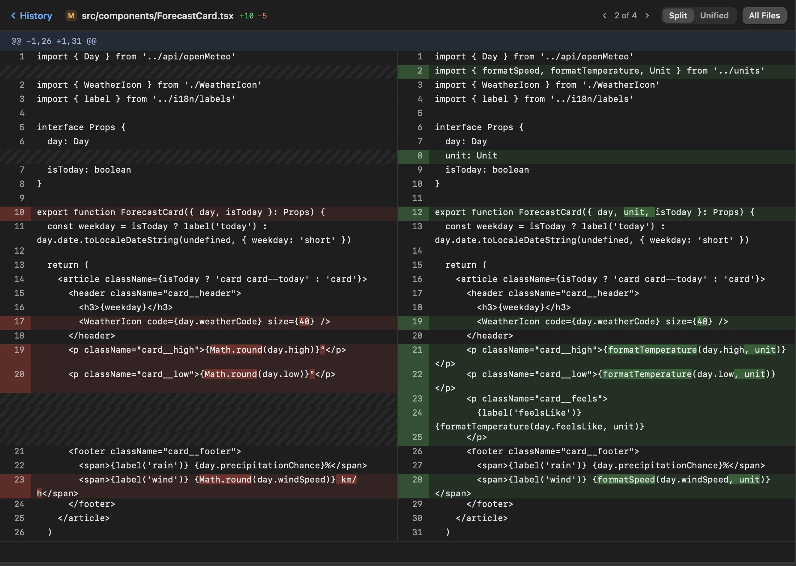
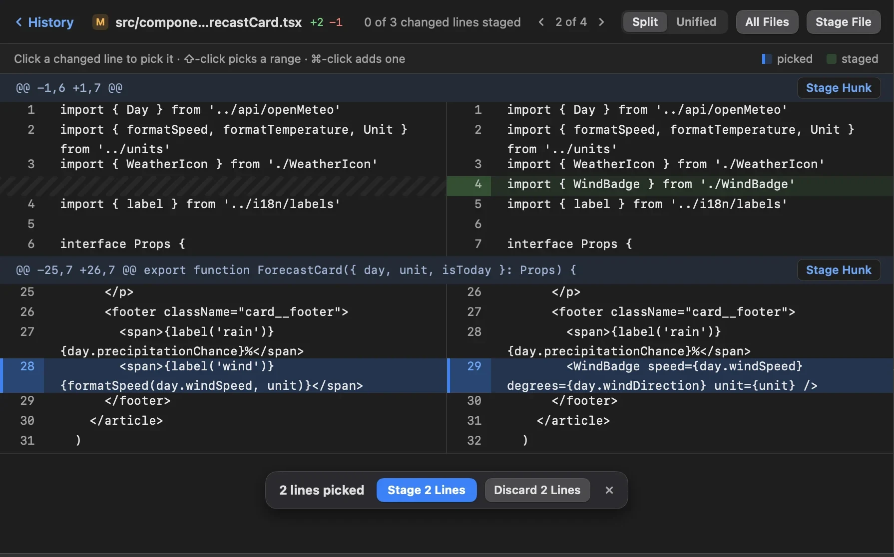
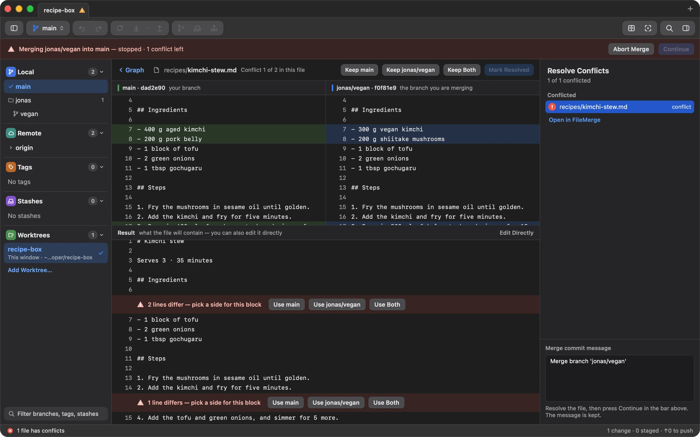

<div align="center">
  

  <h1>Kaern</h1>

  <p><strong>A native Git client for macOS. Free and open source.</strong></p>

  <p>
    <a href="https://github.com/progresshans/kaern/releases/latest"></a>
    <a href="LICENSE"></a>
    
    
  </p>

  <p><a href="https://kaern.progresshans.com">kaern.progresshans.com</a></p>
</div>

Kaern keeps every repository you work on in reach, draws a history you can read at a glance, and lets you commit
exactly the lines you mean, with ⌘Z for almost everything you do. It runs the git you already have, with your config,
your hooks and your SSH keys, and needs no account.

<p align="center">
  
</p>

## What it does

### Every repository in reach

- **Tabs, a sidebar list or one toolbar button**: switch repositories the way you like (Settings › General). Related
  repositories can share a group.
- **Back where you left off**: the windows and tabs you had open come back at launch, or wait behind Reopen in the
  start window.
- **GitHub and GitLab**: sign in once to clone your repositories, or create one and publish it.

<p align="center">
  
</p>

### A history you can read

- **The graph**: each branch keeps its color; tags and remote branches sit beside their commits.
- **Bot updates**: runs of commits by dependency bots fold into one row, or leave the graph.
- **Signed commits**: a shield on every signed commit, and who signed it with which key.
- **Search and Quick Open**: find commits by message, author or change; jump to any commit or file with ⇧⌘O.

<p align="center">
  
</p>

### See exactly what changed

- **Diffs**: side by side or in one column, with the changed words marked.
- **Images**: 2-up, swipe and onion skin.
- **File history and blame**: every commit that touched a file, through renames, and who last changed each line.

<p align="center">
  
</p>

### Commit exactly what you mean

- **Stage single lines**: pick the lines that are ready and stage only those.
- **Undo with ⌘Z**: commits, checkouts, resets, discards, branch and stash changes can be taken back, and done again
  with ⇧⌘Z. A discarded change is kept in Stashes first.

<p align="center">
  
</p>

### Branch, merge and rewrite with confidence

- **Compare branches**: where two branches split, what each has that the other doesn't, and every file that differs.
- **Interactive rebase**: reorder, squash, fix up and reword; Kaern says whether a normal push still works afterwards.
- **Merge conflicts**: keep one side or both for each conflict, and see the result before you continue.
- **Worktrees and stashes**: next to your branches in the sidebar.

<p align="center">
  
</p>

And cherry-pick and revert, amend, tags, submodules, Git LFS, commit hooks, big repositories (history loads as you
scroll), and **Window › Command Log**, which lists every git command Kaern runs.

## Requirements

- A Mac with Apple silicon, running macOS 26 or later.
- Git: the one from Xcode or the Command Line Tools, or any other you choose in Settings › Advanced.

## Install

1. Download `Kaern.dmg` from the [latest release](https://github.com/progresshans/kaern/releases/latest).
2. Open it and drag Kaern to Applications.

Releases are signed with a Developer ID and notarized by Apple. Kaern checks for updates with
[Sparkle](https://sparkle-project.org) (Kaern › Check for Updates…); to try betas, turn on
Settings › General › Updates › Get beta versions.

To check a download, run this in the folder you downloaded the files to, with the release's `SHA256SUMS`:

```sh
shasum -a 256 -c SHA256SUMS --ignore-missing
```

## Build from source

With Xcode 26 or later on an Apple silicon Mac:

```sh
./script/build_and_run.sh          # build the Debug app and open it
./script/build_and_run.sh --test   # run the KaernKit tests
```

To time Command Log redaction separately, run
`KAERN_BENCHMARK_REDACTION=1 ./script/build_and_run.sh --test --filter measureRedactionOnLongDiff`.

macOS knows an app by its signature. With a Developer ID Application certificate in your keychain, the script signs
the Debug app with it, as `script/release.sh` does, so every build keeps the folder access you gave Kaern. Without
one, the app is signed to run locally, and macOS asks again for Documents and other protected folders after each
build. `KAERN_SIGN_IDENTITY` picks another certificate, and `-` signs to run locally.

The app is `Kaern/` (SwiftUI on AppKit); the git engine and its tests are the `Packages/KaernKit` Swift package.
[Packaging/README.md](Packaging/README.md) describes releases. The website, kaern.progresshans.com, has a repository of
its own.

## License

Copyright © 2026 HyeonJin Han

Kaern is free software: you can redistribute it and/or modify it under the terms of the GNU Affero General
Public License as published by the Free Software Foundation, either version 3 of the License, or (at your
option) any later version (SPDX: `AGPL-3.0-or-later`).

Kaern is distributed in the hope that it will be useful, but WITHOUT ANY WARRANTY; without even the implied
warranty of MERCHANTABILITY or FITNESS FOR A PARTICULAR PURPOSE. See [LICENSE](LICENSE) for the full text.
